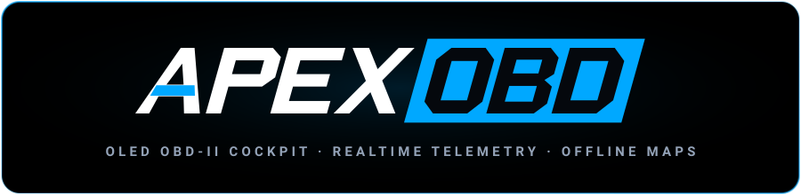

  

  <strong>Turn your Android phone into a pure-black OLED motorsport cockpit, fuel computer, and GPS telemetry logger.</strong>

  
  
  
  

---

## Built for Real Drives, Not Cluttered Menus

Most OBD-II apps bury live gauges behind dated menus, laggy needles, and paid subscriptions. **ApexOBD** gives you a distraction-free `#000000` OLED cockpit that stays locked onto your adapter in the background, streams live ECU data at display refresh rate, and turns every drive into a shareable route card — with **zero ads, zero accounts, and zero API keys**.

  
   
  <em>Live HUD cockpit captured in-car: Track Chrono RPM with shift indicator, MapLibre vector navigation, live fuel economy, coolant, voltage, load, and throttle.</em>

---

## Highlights

### Zero-Chrome OLED HUD Cockpit
- **Pure `#000000` OLED canvas** with zero persistent toolbars while driving — swipe vertically between custom dashboard pages, or long-press any tile to style, resize, move, or remove it.
- **60 FPS VSync-smoothed gauges** that eliminate choppy ELM327 step jumps without adding lag, with selectable **Digital**, **Radial**, **Semi-Arc**, **Line Bar**, **Boxed LED Bar**, **Sparkline Chart**, and **Live Map** widgets.
- **Windshield HUD Mirror mode** and customizable visual themes, card styles, and grid layouts.

### 4 Motorsport RPM Tachometers & Progressive Shift Lamp
Choose from four dedicated RPM radial gauges scaled automatically to your vehicle's redline, with an optional **Green → Yellow → Flashing Red** peak-brightness shift lamp and optional **Warning / Critical alerts** on any other metric (such as high Coolant Temp or low Battery Voltage).

  
   
  <em>GT Motorsport Tach · Sequential F1 Shift LEDs · Track Chrono · Compact OLED Halo</em>

### Smart Fuel, Range & Odometer Telemetry
- Real-time **Instant KPL**, **Trip Avg**, **All-Time Avg**, **Fuel Used**, **Fuel Left (`L` & `%`)**, and conservative **Estimated Range (DTE)** calibrated per vehicle profile and refuel checkpoint.
- **Toyota / Daihatsu Combination Meter (`7C0`) auto-detection:** Automatically reads digital fuel tank level (with OEM-style slosh damping) and syncs your car's exact ECU odometer without manual updates.
- **Multi-vehicle garage:** Switch between cars with independent specs, redline, tank capacity, refuel logs, and trip history.

### 100% Free Offline Maps & Shareable Route Cards
- Built on **MapLibre** with free vector styles, offline `.pmtiles` map packs, and an **OLED Track Only** trail mode — works completely offline while connected to a Wi-Fi OBD-II adapter.
- Record GPS + full OBD-II telemetry runs in the background and export **customizable PNG Route Share Cards** (route map, distance, average economy, speed, peak RPM, and optional background photo) plus raw **CSV / JSON** logs.

### Diagnostics & Universal Adapter Support
- **Works with any ELM327 adapter:** **Wi-Fi (TCP/IP)**, **Bluetooth Classic (SPP)**, **Bluetooth Low Energy (BLE)**, and **USB-Serial (OTG)**.
- **Full diagnostics:** Scan and clear Confirmed, Pending, and Permanent fault codes (`Modes 03 / 07 / 0A / 04`), read VIN (`Mode 09`), explore live supported PIDs, import custom Torque CSV PIDs, and run a read-only Deep ECU Scan.

---

## Supported Adapters

| Connection | Typical Hardware | Notes |
| --- | --- | --- |
| **Wi-Fi (TCP/IP)** | ELM327 Wi-Fi (`192.168.0.10:35000`) | Dedicated Wi-Fi socket binding with low-latency lock & pure-GNSS GPS |
| **Bluetooth Classic** | ELM327 SPP / OBDLink / Vgate | Standard RFCOMM serial pairing |
| **Bluetooth LE (BLE)** | Vgate iCar Pro BLE / Veepeak BLE | In-app BLE scanner |
| **USB-Serial (OTG)** | FTDI, CP210x, CH340, CDC-ACM | Plug-and-play via USB OTG cable |

---

## Download & Install

1. Download the latest signed release APK from the [**Releases**](../../releases) page.
2. Open the APK on your Android 8.0+ phone.
   > **Note on direct APK installs:** Android requires a one-time *"Allow from this source"* confirmation when installing any APK outside Google Play. ApexOBD release APKs are permanently signed with the official release certificate so future updates install cleanly in place.
3. Pair or connect your OBD-II adapter, set up your car profile on the Home Menu, and tap **Open HUD**.
