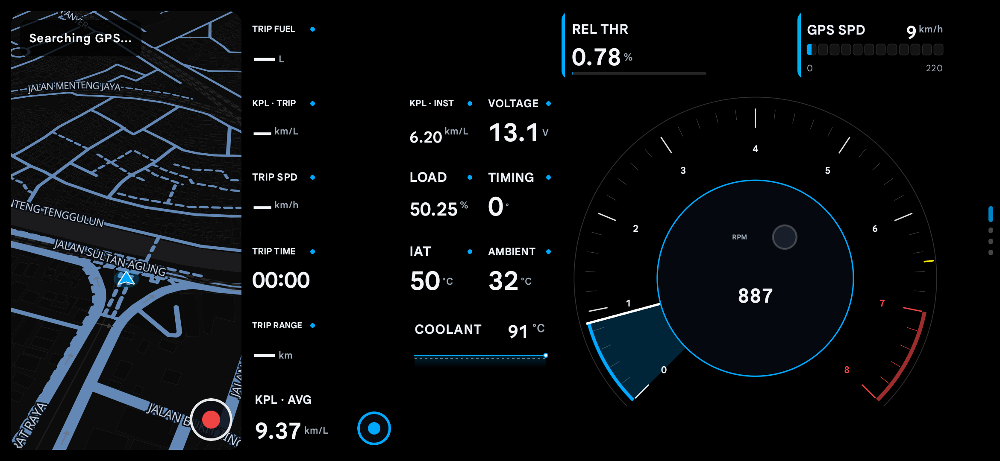
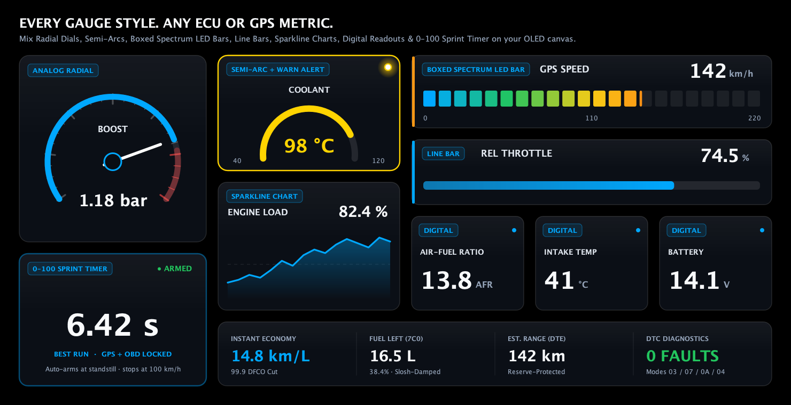
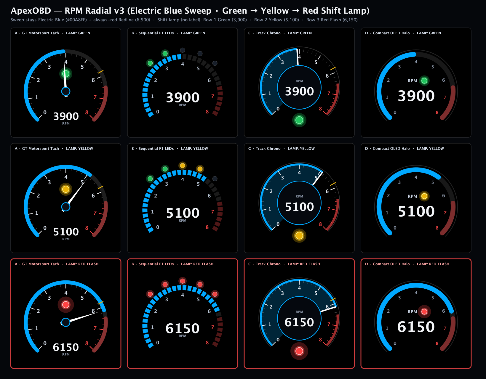
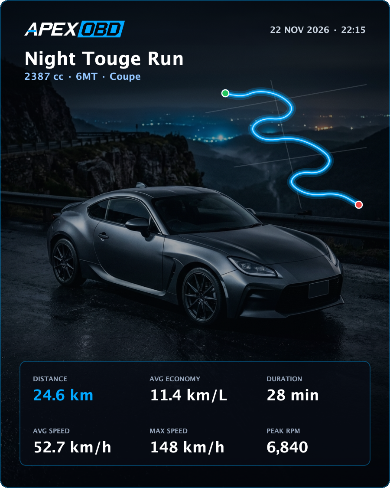

  

<h2 align="center">Your Car Talks. Actually See It.</h2>

  <strong>Turn any Android phone into a pure-black OLED motorsport cockpit, fuel computer, and GPS telemetry studio.</strong> 
  Built for midnight touge runs, weekend track days, and daily drives — with <strong>zero ads, zero subscriptions, and zero API keys</strong>.

  
  
  
  

---

## Pure `#000000` OLED Cockpit — Zero Distractions

Stock dashboards hide the numbers enthusiasts care about — boost pressure, intake temps, real coolant temperature, engine load, timing advance, and true fuel economy. **ApexOBD** replaces cluttered gauges with a borderless, pure-black OLED cockpit that stays locked onto your OBD-II adapter in the background and renders at silky 60 FPS display refresh.

  
   
  <em>Real in-car capture: Track Chrono RPM, offline MapLibre vector navigation, live fuel economy, coolant, voltage, load, and throttle.</em>

---

## Every Gauge Style. Any ECU or GPS Metric.

Build your own cockpit from scratch on a clean canvas. Long-press anywhere to add sensors, pick the exact visual style, drag tiles freely or snap to grid, and set optional **Amber Warning** and **Flashing Red Critical** alerts on any metric (like overheating coolant or dropping battery voltage).

  
   
  <em>Analog Radial · Semi-Arc with Warning Beacon · Boxed Spectrum LED Bar · Line Bar · Sparkline Chart · Digital Tiles · 0–100 km/h Sprint Timer</em>

---

## 4 Motorsport RPM Tachometers & Peak-Brightness Shift Lamp

Choose from four dedicated RPM radial models automatically scaled to your car's redline. Keep your eyes on the road with an optional progressive **Green → Yellow → Flashing Red** shift lamp — calibrated to your shift point so you nail every upshift in peripheral vision.

  
   
  <em>GT Motorsport Tach · Sequential F1 Shift LEDs · Track Chrono · Compact OLED Halo</em>

---

## Turn Every Drive Into a Shareable Route Card

Finish a canyon run, road trip, or morning commute and export a crisp, high-resolution **Route Share Card** in seconds — styled like your favorite fitness tracker, built specifically for cars.

- **Your car, your style:** Overlay your glowing GPS route trace and live telemetry stats onto your **own car photo**, a dark motorsport grid, or a **transparent PNG** ready for Instagram Stories and Reels (`1:1`, `4:3`, and `9:16` layouts).
- **Pick the stats that matter:** Customize up to 6 telemetry metrics per card — **Distance, Avg Economy, Duration, Avg Speed, Max Speed, Peak RPM, Fuel Used**, and optional **surrounding road network** context.
- **Full raw data when you want it:** Export complete GPS + OBD-II run telemetry to **CSV** or **JSON** anytime.

  
   
  <em>ApexOBD Route Share Card export — custom car photo background, glowing GPS route spline, vehicle specs, and telemetry summary.</em>

---

## Engineered for Enthusiasts & Daily Drivers Alike

- **Smart Fuel Computer & Multi-Vehicle Garage:** Track **Instant KPL**, **Trip Avg**, **All-Time Avg**, **Fuel Left (`L` & `%`)**, and reserve-protected **Estimated Range (DTE)** across multiple cars with independent redlines, tank capacities, and refuel logs.
- **Automatic Toyota / Daihatsu Cluster (`7C0`) Sync:** Automatically discovers supported Combination Meter channels for slosh-damped digital fuel tank level and hands-free odometer sync.
- **100% Free Offline Maps:** Powered by MapLibre with vector styles, offline `.pmtiles` map packs, and an **OLED Track Only** mode — works seamlessly even while your phone's Wi-Fi is locked onto a Wi-Fi OBD-II adapter.
- **Windshield HUD Mirror Mode:** Flip the entire cockpit horizontally in one tap for nighttime windshield projection.
- **Full Diagnostics & Custom PIDs:** Scan and clear Confirmed, Pending, and Permanent fault codes (`Modes 03 / 07 / 0A / 04`), read VIN, inspect live supported PIDs, import custom Torque CSV PIDs, and run a read-only Deep ECU Scan.

---

## Works With Your OBD-II Adapter

| Connection | Typical Hardware | Highlights |
| --- | --- | --- |
| **Wi-Fi (TCP/IP)** | ELM327 Wi-Fi (`192.168.0.10:35000`) | Dedicated OBD Wi-Fi binding, low-latency lock & pure-GNSS GPS |
| **Bluetooth Classic** | ELM327 SPP / OBDLink / Vgate | Standard serial pairing |
| **Bluetooth LE (BLE)** | Vgate iCar Pro BLE / Veepeak BLE | Built-in BLE adapter scanner |
| **USB-Serial (OTG)** | FTDI, CP210x, CH340, CDC-ACM | Zero-latency wired plug-and-play |

---

## Download & Install

1. Grab the latest signed release APK from the [**Releases**](../../releases) page.
2. Open the APK on your Android 8.0+ phone.
   > **Note on direct APK installs:** Android shows a one-time *"Allow from this source"* confirmation when installing apps outside Google Play. ApexOBD release APKs are permanently signed with the official release certificate so future updates install cleanly in place.
3. Connect your OBD-II adapter, set up your car profile on the Home Menu, and tap **Open HUD**.
